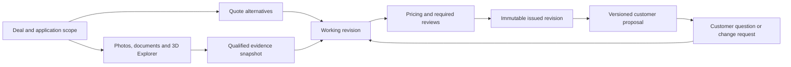

# PAC Sales Workspace: product architecture

**Visual reset update — 7 November 2026:** the user authorized removal of WinQuote visual and page-organization influence. The current implementation target is [PAC-VISUAL-RESET.md](PAC-VISUAL-RESET.md), superseding earlier visual-baseline and pending-selection notes. Pricing, save and version contracts remain in force.

Status: proposed architecture for review. Updated 2026-11-07. This is a product and implementation brief, not a claim that the proposed application is already built or production-ready.

Validation gap: the full WinQuote/MPI application journeys and portability of their capabilities have not been demonstrated in this pass. [VALIDATION-PLAN.md](VALIDATION-PLAN.md) now places runnable source inspection and a bounded integration check before the PAC implementation slice below.

## 1. Product decision

Build a sales application for configuring and discussing industrial equipment, with PAC as the first implementation. Learn business capabilities from MPI and WinQuote; design the experience around PAC's users, equipment and sales decisions.

The previous Winter-style PAC release remains the functional baseline. Its visual treatment is no longer the target. Build the quoting, review and feedback capabilities into native application screens with a shared context, navigation and recovery model. Reusing a backend through an adapter does not require embedding its old UI.

**Primary job:** help a sales representative turn an application conversation into reviewed alternatives, present them with relevant evidence, and leave the customer and team with a clear next action in the same deal.

The requirements document says quoting is the first product priority. The agreed demo sequence starts with the proposal, then shows the workspace that produced it. These are different orders and both remain valid.

### Product outcomes to measure in a pilot

- Time from a sufficiently specified application to a reviewable quote.
- Unresolved application questions and unpriced exceptions before issue.
- Rework caused by incorrect options, media, terms or stale revisions.
- Proposals with an owner, a next action and an agreed follow-up.
- Customer decision time and win/loss reasons, compared with PAC's own baseline.

These are proposed measures, not achieved results or numerical promises.

## 2. What the source systems contribute

| Source | Reuse at the product level | Do not inherit automatically |
| --- | --- | --- |
| PAC requirements | Deal first, application scope, alternative quotes, standard/custom/special-order distinctions, engineering pricing, approvals, interactive proposal, CRM and self-service catalog needs | Internal proposal timelines or assumptions as customer commitments |
| MPI | Explicit option rules and exceptions, configuration editing boundaries, versioned records, guarded output and review tasks | MPI product families, machine vocabulary, complex ETO behavior or its current visual layout |
| WinQuote | Quote continuity, exact-document customer review, role-specific actions, activity and integration boundaries | Its screen composition, refrigeration tabs, quote-folder data shape, or TODO-only downstream controls |
| Feedback Flow handoff | Contextual launcher, draft recovery, actionable return notices, immutable question/answer/candidate history | Assuming the full demonstrated workflow is implemented by the existing feedback intake API |
| Current PAC demo | Tested catalog rules, alternative/revision separation, issued snapshots, engineering blockers and 3D capture/restore | Browser-local storage or demo role switching as production persistence or authorization |
| Existing harness | Evidence-bound work packages, explicit authority, fresh review and controlled handoff | A visual template or proof that a product decision is good |

Source inspection establishes what is present in the inspected checkout. Production integration must be verified separately. See `SOURCE-LEDGER.md` for identities and evidence boundaries.

## 3. The application people should experience

### Internal navigation

Use a small, stable application navigation. Do not make every implementation module a sidebar item.

| Surface | User's job | Main content and action |
| --- | --- | --- |
| My work | Know what needs my action | Assigned application questions, engineering estimates, reviews and follow-ups; counts represent work, not every unread message |
| Deals | Find and progress an opportunity | Searchable list with optional pipeline view; customer, owner, stage, last contact, next action; open the deal |
| Reviews | Clear requests across deals | Role-filtered queue; exact quote/revision, change summary, blockers and approve/request-changes action |
| Catalog & media | Find or maintain approved product information | Model/option lookup, exact-model media and effective catalog version; administration actions are permission-bound |
| Settings | Manage workspace configuration | Roles, approved review policy, connector status and brand settings; only show supported capabilities |

A deal is the persistent work context. Its workspace has **Overview, Quotes, Proposal, Evidence and Activity**. Overview holds the application and next action. Quotes holds alternatives; a selected alternative opens its revision editor. Proposal composes issued alternatives for presentation. Evidence includes photos, videos, drawings and 3D references. Activity links to the exact source record and distinguishes events from unsaved edits.

The return arrow creates or updates a working revision; it never changes the issued revision or the original customer response.

### Quote editor

The editor has one stable context row: deal, alternative, revision, save state and the next allowed action. Configuration, engineering requirements, commercial terms and review are tasks inside this quote, not independent top-level applications.

- Show selected configuration and editable option groups together. Keep the financial effect and constraints close to the choice.
- Distinguish included items, additional priced options, engineering requirements and special orders in both structure and totals.
- Explain a required companion or incompatibility before applying a choice. Do not silently add cost.
- Route engineering work to its owner while preserving the sales context and discussion.
- Show unresolved items as unresolved; an unknown amount is not zero.
- Surface a concise review summary: what changed, why it matters, who must review, and what blocks issue.
- Preserve working edits across tabs, minimize/return and reload. Stale or conflicting saves need recovery, not silent overwrite.

### Customer proposal

The customer sees an issued presentation, not the internal editor with controls hidden. It contains application understanding, alternatives, exact-model media, relevant benefits, itemized commercial content and source terms. Comments and requested changes attach to a specific issued proposal/quote revision and, where relevant, a section or line.

The first screen should answer: **what is being recommended, why it fits the stated application, what the alternatives change, and what the customer needs to decide next.** Price hiding in an internal presentation is a convenience; it is not a security boundary.

Media must be applicable to both the exact machine and the selected configuration. Record model and option applicability, asset version, approval status and any visible differences. Before issue, block an asset represented as exact if its applicability is unknown or mismatched; use an explicitly qualified application example only when the presentation makes the differences clear. Correct model identity alone does not establish a correct configuration image.

### 3D Explorer

Explorer is a focused inspection surface within the deal's evidence flow. Open it from a product or application question, inspect/capture, review the note, attach to the chosen deal/quote, then return to that record. A catalog-first exploration can start outside a deal, but attaching requires an explicit existing or new deal.

A capture records model identity/revision, component identity, camera and motion state, timestamp, note and ownership. It never adds a priced option or proves physical fit by itself. PAC CAD remains unconfirmed; the current assembly must retain its reference-only qualification.

### Product Feedback

One contextual Feedback launcher supports compact reporting and an expanded workspace. It inherits the current authorized app/page/record/revision context and preserves drafts. It does not compete with the sales navigation.

**Keep two different systems distinct:**

| System | Meaning of the record | Completion |
| --- | --- | --- |
| Proposal discussion / change request | A customer's question or requested commercial/application change | The question is answered or a specific revised proposal is reviewed |
| Product-feedback ticket | A problem or improvement in the software | The requester accepts a submitted software candidate; release authorization remains a separate owner action |

They can share attachment, conversation and notification primitives. They must not share an overloaded acceptance status. A preferred quote is not an order; customer acceptance is not internal pricing approval; a resolved bug flag is not release approval.

## 4. Domain model and invariants

| Record | Ownership and immutable boundary |
| --- | --- |
| Workspace / actor | Owns identity, roles, permissions and client policy. Demo roles remain simulation inputs. |
| Account / contact | Referenced through the authorized CRM/customer adapter; no second editable master by default. |
| Deal | One opportunity, application scope, owner, stage and next action. CRM identity required before official quote numbering. |
| Quote alternative | One candidate equipment configuration within a deal. It is not another revision of a different alternative. |
| Working revision | Editable configuration, commercial content and engineering requirements, with a concurrency/version token. |
| Issued revision | Frozen scope, product/catalog snapshot, lines, totals, terms, approvals and adopted evidence. |
| Catalog version | Approved product, compatibility, inclusion and pricing rules with effective dates. Publishing a new catalog does not rewrite issued quotes. |
| Engineering requirement | Description, reason, affected feature/option, responsible owner, labor/material assumptions and delivery impact. |
| Review decision | Actor, permission, exact content/scope fingerprint, timestamp and reason. Relevant edits invalidate the decision. |
| Evidence snapshot | Stable asset/model version, machine/option applicability, approval and qualification state, and captured context; adopted references are frozen with the issued revision. |
| Proposal version | An explicit manifest of issued quote revisions, content blocks, evidence and terms. It is not recomputed from whichever revisions are latest today. |
| Customer response | Recipient, proposal version and referenced quote/section, with its original wording and attachments. |
| Task / notification / activity | Distinct records or read models: required action, informational delivery/read state, and actual business event. |
| Feedback ticket / candidate | Separate software-improvement lifecycle with immutable sent questions, answers and candidate-version basis. |

The current PAC demo has immutable issued quotes but its proposal projection selects the latest issued alternative revisions. A stable, shareable **ProposalVersion manifest is new work** required before production customer links or multi-user review.

### Lifecycle rules

A deal stage summarizes the sales process; it does not replace quote review state. A working quote can be saved with missing information, but cannot issue while mandatory scope, pricing or required approvals are unresolved. Issue creates an immutable revision. A later change creates a new working revision; it never edits the issued one.

An issued proposal binds exact alternative revisions. Replacing one alternative creates a new proposal version. Existing comments, customer responses and earlier links retain their original basis. Revocation, expiry and an explicitly marked superseded state are separate from historical deletion.

Published catalog changes affect new work by explicit reconciliation. Rule, price, rounding and commercial-term ownership must remain with the authoritative domain service. UI customization cannot alter those facts.

## 5. Implementation boundaries

Use a modular application, not a generic workflow engine or a new microservice per screen. The following boundaries are proposed logical modules; they do not require separate deployments.

| Layer | Responsibility | Must not own |
| --- | --- | --- |
| Application UI | Routes, task composition, tables, editor, customer presentation, context and recovery | Independent pricing formulas or permission decisions |
| CPQ domain | Catalog selection, compatibility, engineering costs, revisions, review validity and proposal manifests | Brand tokens, menu labels or browser layout |
| Workflow application layer | Execute authorized commands, resolve task ownership, expose blockers and emit durable events | Approval inferred from elapsed time or a hidden button |
| Client profile | PAC catalog vocabulary, reviewed business policy, media rules, enabled modules and visual theme | Arbitrary scripts that bypass domain invariants |
| Adapters | CRM, legacy CPQ, documents, auth, notifications, signatures/payments and Explorer | Unverified success state or duplicate master data |
| Harness, outside the product | Build/review artifacts, evidence, acceptance scope and release records | User-visible sales workflow state |

React/TypeScript is a reasonable proposed UI implementation because the inspected MPI and WinQuote integration surfaces already use it. This is not a mandate to transplant their components or install a new framework now. Keep the tested PAC domain behind a stable interface during the first UI slice; evaluate production persistence and exact dependencies in their own implementation packet.

For each deployment, explicitly select the authoritative owner of quotes and catalog. A legacy-backed deployment calls that backend through a mapping adapter. A new PAC service owns its own domain. Do not let a new UI store and a legacy backend independently write the same authoritative quote.

### Command contract examples

- `SaveQuoteDraft(quoteId, expectedVersion, patch)` returns the saved version or a conflict preserving the edit.
- `EvaluateConfiguration(catalogVersion, selections)` returns included/add-on lines, dependencies, exclusions and review reasons.
- `SubmitReview(quoteId, revisionId, contentHash, decision)` validates actor and the current content.
- `IssueQuote(quoteId, expectedVersion, idempotencyKey)` atomically verifies required reviews and freezes the snapshot.
- `CreateProposalVersion(dealId, issuedRevisionIds, contentManifest)` binds the customer-facing artifact.
- `RecordCustomerResponse(proposalVersionId, reference, body, idempotencyKey)` enforces recipient access and exact version.
- `AttachEvidence(dealId, quoteId, assetVersion, capturedView)` validates ownership and source identity.

These names describe proposed operations, not existing endpoints. Production requires server authorization, tenant/recipient isolation, concurrency control, durable attachments and retry-safe commands. A small modular backend with transactionally stored records and event delivery is sufficient initially; event sourcing and a generalized workflow engine are not required.

### Reuse strategy

Reuse contracts, proven behavior, tests and suitably isolated modules. Keep MPI configuration behavior, WinQuote review/document behavior and Feedback gateway behavior behind explicit adapters. Their IDs, states and data shapes differ. A map from external IDs to canonical references must record source system and revision, not guess from labels or folder names.

## 6. Customization without a fork per customer

Define three reviewed profiles with distinct responsibilities:

1. **Business profile:** catalog, included/add-on classification, engineering inputs, lead-time rules, approval exceptions and numbering policy.
2. **Experience profile:** enabled modules, terminology, entry points and task emphasis, constrained by stable navigation and accessibility contracts.
3. **Brand profile:** logo, type, semantic color roles, density, surfaces and media treatment.

Keep these as versioned configuration plus explicit extension components. Do not make every screen a schema-driven form; the high-value configurator and proposal need designed interactions. Do not encode business rules in a theme file. A visual change may never change totals, eligibility or review validity.

Competitive research should test the value proposition, not just supply screenshots. QuoteWerks/QuoteValet already covers much of interactive quote delivery and CRM handoff. A link, comments or electronic acceptance alone is not a defensible differentiator. The hypothesis to test with PAC is a better live application conversation, simpler standard-machine configuration, relevant engineering collaboration and trustworthy exact-model evidence across alternatives.

See `DESIGN-RESEARCH.md` for the proposed visual directions. No rendered replacement has been selected yet. The next visual review should show the same representative deal in a **deal workspace, quote editor and customer proposal**, so the direction is judged as a product rather than a homepage.

## 7. Build and acceptance sequence

| Packet | Concrete result | Evidence required to advance |
| --- | --- | --- |
| P0: architecture, this packet | Capability boundaries, product model, proposed navigation, reference research and implementation brief | Source identities, requirement mapping and independent contradiction review |
| P1: first product slice | One coherent application experience for the same deal: workspace, quote editor, proposal and contextual Explorer return | Selected visual target; desktop/mobile captures; real configuration/review/revision flow; all prior domain invariants preserved |
| P2: production foundations | Auth, durable storage, CRM deal/number gate, role review, stable proposal sharing, customer response and notifications | Server-side authorization/isolation tests, concurrency/retry tests, exact-version link tests and staging integration receipts |
| P3: catalog operations | Import/review/publish, annual and item-level changes, media association and audit | Source reconciliation, approved catalog version, no retrospective quote repricing and rollback |
| P4: extensions | Deeper Feedback workflow, signature/payment and selected operational handoff | Approved requirement, actual provider contracts and independently verified end-to-end capability |

P1 can demonstrate existing local capabilities, but cannot be called production integration. Signature/payment are recorded PAC requirements for a later connected slice, not permanently excluded. ERP, manufacturing scheduling and automatic CAD generation are not first-slice needs supported by the PAC requirements.

Do not estimate a delivery date from the old handoff's internal timeline. Sequence and scope come before a staffing and deployment estimate.

### First slice acceptance

- The customer can understand and compare two issued alternatives before entering the internal workspace.
- The presenter opens the same deal and can see scope, owner, blocking work and next action.
- A valid option choice changes the correct alternative; companion costs are disclosed; incompatible choices are blocked.
- Unpriced engineering work blocks issue. The appropriate actor prices/reviews it; a later relevant edit invalidates approval.
- Explorer capture returns to the same deal/quote, with exact evidence identity and reference-model qualification.
- The proposal's media is checked against both model and selected configuration; mismatched or unverified option imagery cannot be presented as the exact quoted machine.
- Issue preserves earlier revisions; a customer response stays on the version it addressed.
- Save, reload, back/forward, tab switches and background/return preserve the correct record and edits.
- Customer presentation never exposes internal cost/rate/approval notes. In production this is enforced by the server projection.
- Actual desktop and narrow-screen behavior is inspected, including long tables, long notes, no-data, error, permission and pending states.
- PDF generation/open/return and native save are separate checks. A preview or fallback file is not proof of a successful new native save.

## 8. Decisions that remain with PAC or the product owner

The proposed architecture can proceed without inventing these answers: CRM identity and available integration; official quote numbering; review roles and override thresholds; catalog ownership and publication process; approved model/media assets; customer sharing/acceptance expectations; first machine-family coverage.

For the next design pass, the product owner should review the proposed navigation and choose a rendered visual direction. This packet recommends a direction but does not record visual approval or authorize production integration. Current published PAC functionality is preserved while that replacement is designed.
